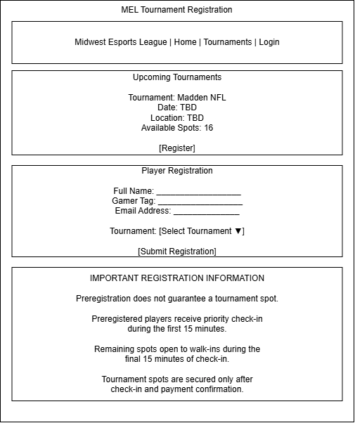
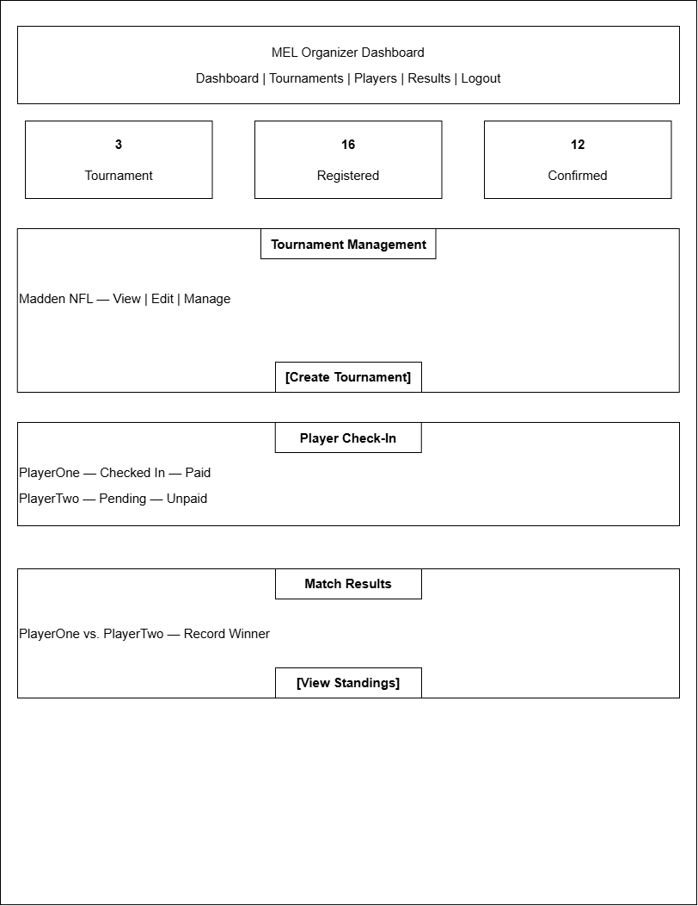
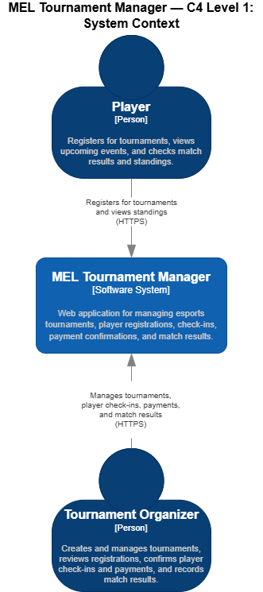
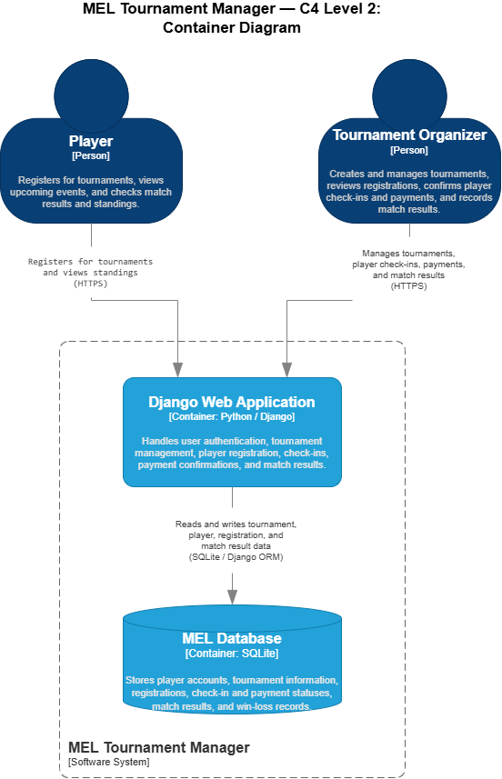

# Project Documentation

This directory contains the project requirements,
user stories, security considerations, interface
mockups, and architecture diagrams for the
Midwest Esports League Tournament Manager.

## User Stories

### User Story 1: Tournament Registration

As a **player**, I want to **register for an upcoming esports tournament**, so I can **express my interest in participating and receive priority during event check-in**.

**Acceptance Criteria:**

- Players can view upcoming tournaments.
- Players can submit their name, gamer tag, and email address.
- Players can select an available tournament.
- The application records the registration date and time.
- Players receive an on-screen confirmation after registering.
- The confirmation clearly states that preregistration does not guarantee a tournament spot.
- Tournament spots are secured only after payment and check-in at the event.

### User Story 2: Tournament Management

As a **tournament organizer**, I want to **create and manage esports tournaments**, so I can **organize events and track player participation efficiently**.

**Acceptance Criteria:**

- Organizers can create tournaments with a name, date, time, location, and maximum number of participants.
- Organizers can view and edit existing tournaments.
- Organizers can view the list of registered players for each tournament.
- The application displays the number of registered players and available tournament spots.
- Only authorized organizers can create, edit, or delete tournaments.

### User Story 3: Match Results and Player Records

As a **tournament organizer**, I want to **record match results and track player wins and losses**, so I can **monitor tournament progress and maintain accurate player records**.

**Acceptance Criteria:**

- Organizers can select two registered players for a match.
- Organizers can record the winner and loser.
- The application automatically updates each player's win and loss totals.
- Organizers can view player records for each tournament.
- Only authorized organizers can enter or modify match results.
- Correcting a match result updates the affected player records.

### User Story 4: Tournament Check-In and Payment Confirmation

As a **tournament organizer**, I want to **check in registered players and confirm their payments**, so I can **accurately manage tournament participation and available spots**.

**Acceptance Criteria:**

- Organizers can view all preregistered players for a tournament.
- Organizers can mark players as checked in.
- Organizers can manually confirm whether payment has been received.
- The first 15 minutes of check-in are reserved for preregistered players.
- During the final 15 minutes, organizers can add walk-in players to remaining available spots.
- Preregistration does not guarantee a tournament spot.
- A tournament spot is secured only after check-in and payment confirmation.
- The application prevents confirmed participants from exceeding the tournament's maximum capacity.
- Only authorized organizers can modify check-in and payment statuses.

## Mis-User Stories

### Mis-User Story 1: Unauthorized Tournament Management

As a **malicious user**, I want to **gain unauthorized access to tournament management functions**, so I can **modify tournament information, manipulate player registrations, or falsify match results**.

**Mitigation Criteria:**

- Tournament management functions require authentication.
- Only authorized organizers can create, modify, or delete tournaments.
- Only authorized organizers can modify player check-in, payment status, and match results.
- The application enforces role-based access control on the server.
- Unauthorized requests are rejected with an appropriate HTTP error response.
- Administrative actions are logged for accountability.

### Mis-User Story 2: Fraudulent Tournament Registrations

As a **malicious user**, I want to **submit multiple fraudulent tournament registrations**, so I can **manipulate registration records, disrupt tournament organization, and prevent legitimate players from participating**.

**Mitigation Criteria:**

- The application requires valid registration information.
- The application prevents duplicate registrations using the same account for the same tournament.
- Registration forms include server-side input validation.
- Rate limiting restricts excessive registration attempts.
- Organizers can review and remove suspicious registrations.
- Only authorized organizers can confirm tournament participation.
- Preregistration does not guarantee a tournament spot.
- Tournament spots are secured only after check-in and payment confirmation.

### Mis-User Story 3: Unauthorized Access to Player Information

As a **malicious user**, I want to **access other players' personal information without authorization**, so I can **collect sensitive information for phishing, identity theft, or other malicious activities**.

**Mitigation Criteria:**

- Users must be authenticated to access private account information.
- Players can only view and modify their own personal information.
- Only authorized organizers can access player information required for tournament management.
- The application enforces server-side authorization checks before returning private player data.
- Passwords are securely hashed using Django's built-in password management system.
- Sensitive information is not exposed through public pages or application error messages.
- The application uses HTTPS when deployed to protect information transmitted between users and the server.

## Interface Mockups

### Tournament Registration Page

This mockup illustrates the player registration interface for the Midwest Esports League Tournament Manager. Players can view upcoming tournaments, enter their registration information, and review the tournament check-in policies.

### Organizer Dashboard

This mockup illustrates the administrative dashboard for the Midwest Esports League Tournament Manager. Tournament organizers can manage events, monitor player registrations, confirm check-ins and payments, record match results, and view tournament standings.

## C4 Architecture Diagrams

### C4 Level 1: System Context Diagram

The System Context Diagram illustrates how players and tournament organizers interact with the Midwest Esports League Tournament Manager.

### C4 Level 2: Container Diagram

The Container Diagram illustrates the proposed application architecture. Players and tournament organizers interact with the Django web application over HTTPS. Django uses SQLite to store tournament information, registrations, player records, and match results.

### C4 Level 3: Component Diagram

The Component Diagram illustrates the internal architecture of the Django Web Application.

The application consists of five primary components:

- Authentication
- Tournament Management
- Player Registration
- Check-In & Payments
- Match Results & Standings

These components communicate with one another to manage tournament operations. The Django ORM provides access to the SQLite database, which stores player accounts, tournament information, registrations, payment confirmations, and match results.

